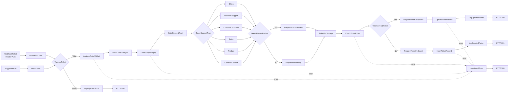

# AI Customer Support & Ticket Triage System

> An end-to-end customer-support automation built with **n8n**, **Groq**, structured LLM outputs, authenticated webhooks, team routing, human-review safeguards, Data Tables, deduplication, audit logging, and centralized error handling.


## Overview

This project automates the intake and first-line triage of B2B customer-support tickets.

A ticket arrives through an authenticated webhook, is normalized and validated, analyzed by an AI model, assigned a category, priority, sentiment, recommended team and SLA, enriched with a customer-facing reply draft, routed to the appropriate support queue, passed through a human-review gate when required, and then inserted or updated in n8n Data Tables.

The workflow also records an audit trail and returns explicit API responses for creation, updates, invalid requests, authentication failures, and internal errors.

### Main capabilities

- Authenticated `POST` webhook endpoint
- Input normalization and required-field validation
- Structured AI triage
- Category, priority and sentiment classification
- Recommended-team routing
- SLA calculation
- Human-review flag and approval gate
- Structured AI reply drafting
- Six support queues
- Ticket deduplication by `ticket_id`
- Create-or-update persistence logic
- Audit/event logging
- Centralized internal-error handling
- Explicit HTTP contract: `201`, `200`, `400`, `403`, `500`
- Manual trigger path for development and testing
- Safety guardrails against credential requests, invented policies, and automatic high-risk decisions

---

## Architecture



---

## AI triage

The triage model returns structured fields including:

```text
category
priority
sentiment
summary
recommended_team
sla_hours
requires_human_review
confidence
tags
analysis_reasoning
suggested_action
```

### Categories

```text
billing
technical
account
sales
feature_request
complaint
other
```

### Priority levels

| Priority | Intended use | SLA guideline |
|---|---|---:|
| `critical` | Security compromise, account takeover, severe blocking outage, immediately harmful issue | 1 hour |
| `high` | Urgent billing/account issue, repeated failure, important disruption, very upset customer | 4 hours |
| `medium` | Standard support issue | 24 hours |
| `low` | General question, feature request, non-urgent request | 72 hours |

### Team mapping

| Category | Recommended team |
|---|---|
| `billing` | `billing` |
| `technical` | `technical_support` |
| `account`, `complaint` | `customer_success` |
| `sales` | `sales` |
| `feature_request` | `product` |
| `other` | `general_support` |

---

## Human-review safety gate

The workflow can require human review before any customer-facing action.

Human review is expected for cases such as:

- critical tickets;
- security or account-takeover concerns;
- significant refund or charge disputes;
- legal threats;
- severe complaints;
- low-confidence AI output.

When human review is required:

```text
workflow_status = awaiting_human_review
auto_reply_allowed = false
```

Otherwise:

```text
workflow_status = ready_for_optional_auto_reply
auto_reply_allowed = true
```

The workflow drafts a response, but the portfolio version does **not** automatically send irreversible or high-risk actions.

---

## AI reply drafting

The second LLM stage creates:

```text
reply_subject
reply_body
reply_tone
internal_note
```

Guardrails in the prompt instruct the model to:

- reply in the customer's language when possible;
- stay concise and professional;
- avoid claiming an issue is already fixed;
- avoid promising refunds, credits or policy outcomes;
- never request passwords, OTP codes, full card numbers or secret credentials;
- avoid exposing internal AI classification, scores or routing;
- keep sensitive/high-risk cases reviewable by a human.

---

## Support queues

The routing stage supports:

```text
Billing Queue
Technical Support Queue
Customer Success Queue
Sales Queue
Product Feedback Queue
General Support Queue
```

Each route attaches an operational `handling_strategy` and a `notify_immediately` flag for high/critical tickets.

---

## Tech stack

| Component | Role |
|---|---|
| **n8n** | Workflow orchestration |
| **Groq** | LLM inference |
| **GPT-OSS 120B via Groq** | Ticket triage and reply drafting |
| **n8n Structured Output Parser** | Predictable model output |
| **n8n Data Tables** | Ticket state + audit-event storage |
| **Webhook Header Auth** | API access protection |
| **Docker** | Recommended self-hosted runtime |

---

## API

### Endpoint

```http
POST /webhook/portfolio/support-ticket
```

The webhook uses header authentication:

```http
Content-Type: application/json
X-Webhook-Secret: YOUR_WEBHOOK_SECRET
```

Never commit the actual webhook secret.

### Example request

```bash
curl -i -X POST "http://localhost:5678/webhook/portfolio/support-ticket" \
  -H "Content-Type: application/json" \
  -H "X-Webhook-Secret: YOUR_WEBHOOK_SECRET" \
  -d '{
    "ticket_id": "TICKET-DEMO-001",
    "full_name": "Sophie Martin",
    "email": "sophie.martin@example.com",
    "subject": "Duplicate charge on my invoice",
    "message": "Hello, I was charged twice for the same order. Please help me understand what happened.",
    "channel": "web",
    "customer_tier": "standard",
    "language": "en",
    "source": "website"
  }'
```

### Required fields

The validation step requires non-empty values for:

```text
ticket_id
full_name
email
subject
message
```

---

## API responses

### New ticket — `201 Created`

```json
{
  "success": true,
  "status": "created",
  "ticket_id": "TICKET-DEMO-001",
  "email": "sophie.martin@example.com",
  "category": "billing",
  "priority": "high",
  "recommended_team": "billing",
  "requires_human_review": true,
  "message": "Support ticket created successfully"
}
```

### Existing ticket — `200 OK`

The ticket is updated while preserving its business `ticket_id`.

### Invalid ticket — `400 Bad Request`

```json
{
  "success": false,
  "status": "rejected",
  "error": "invalid_ticket",
  "message": "Missing or invalid required fields"
}
```

### Invalid authentication — `403 Forbidden`

Authentication is rejected by the n8n webhook credential before business processing starts.

### Internal error — `500 Internal Server Error`

```json
{
  "success": false,
  "status": "error",
  "error": "internal_server_error",
  "message": "An unexpected error occurred"
}
```

The public response deliberately stays generic so provider or implementation details are not leaked.

---

## Persistence and deduplication

The project uses two n8n Data Tables.

### `support tickets`

Stores the latest state of each ticket.

Representative fields:

```text
ticket_id
full_name
email
subject
message
channel
customer_tier
language
source
received_at
category
priority
sentiment
summary
recommended_team
sla_hours
sla_due_at
requires_human_review
confidence
tags
analysis_reasoning
suggested_action
reply_subject
reply_body
reply_tone
internal_note
queue
handling_strategy
notify_immediately
workflow_status
auto_reply_allowed
next_step
analyzed_at
record_updated_at
```

Deduplication is performed by `ticket_id`.

### `support ticket events`

Stores the audit history:

```text
event_id
ticket_id
email
event_type
category
priority
status
source
execution_id
occurred_at
error_type
error_message
```

Event types include:

```text
created
updated
rejected
internal_error
```

---

## Error handling

Critical AI and persistence failures converge on one central path:

```text
Critical node failure
        ↓
LogInternalError
        ↓
RespondInternalError
        ↓
HTTP 500
```

Audit-logger failures bypass the central logger and go directly to the `500` responder, avoiding recursive failure loops.

---

## Security

Implemented controls:

- Header-authenticated webhook
- Webhook secret stored in n8n Credentials
- Groq API key stored in n8n Credentials
- No secret values committed in this repository
- Generic public `500` response
- Validation before AI processing
- Structured model output
- Human-review gate for sensitive/high-risk cases
- No automatic refunds or financial decisions
- No password/OTP requests in generated replies
- Public workflow export stripped of source credential IDs, webhook UUIDs, instance metadata and Data Table IDs

Recommended production hardening:

- stable HTTPS endpoint;
- reverse proxy or authenticated tunnel;
- rate limiting;
- request-size limits;
- execution-data retention policy;
- backups;
- retries/backoff around external providers;
- monitoring and alerts;
- real support-platform integration;
- idempotency controls where appropriate.

---

## Validation and regression tests

Version 1.0 was tested end-to-end with the following cases:

| Test | Expected | Validated |
|---|---|---|
| Create a valid new ticket | `201 Created` | ✅ |
| Send the same `ticket_id` again | `200 OK` | ✅ |
| Omit a required field | `400 Bad Request` | ✅ |
| Use an invalid webhook secret | `403 Forbidden` | ✅ |
| Force an LLM/provider failure | `500 Internal Server Error` | ✅ |
| Audit `created` event | stored | ✅ |
| Audit `updated` event | stored | ✅ |
| Audit `rejected` event | stored | ✅ |
| Audit `internal_error` event | stored | ✅ |
| Restore production credentials and run final smoke test | `201 Created` | ✅ |

Exact AI classification may vary slightly because model generation is nondeterministic.

---

## Running locally

### Prerequisites

- n8n with Data Tables enabled
- Groq API credential
- Docker / Docker Compose if self-hosting

### 1. Import the workflow

Import:

```text
workflow/ai-customer-support-ticket-triage-system.json
```

The public workflow is intentionally inactive and has no credential or source-environment IDs.

### 2. Create the Data Tables

For the quickest setup, import:

```text
data-tables/support-tickets.csv
data-tables/support-ticket-events.csv
```

Each CSV contains one seed row named `__DELETE_AFTER_IMPORT__` so n8n can infer the schema. Delete that seed row after import.

Then select the newly created tables in these nodes:

```text
CheckTicketExists
UpdateTicketRecord
InsertTicketRecord
LogUpdatedTicket
LogCreatedTicket
LogRejectedTicket
LogInternalError
```

### 3. Configure credentials

Create/select:

- a **Groq API** credential in both Groq model nodes;
- a **Header Auth** credential in `WebhookTicket`.

Recommended header name:

```text
X-Webhook-Secret
```

Use your own random secret value.

### 4. Publish the workflow

After all red configuration warnings are resolved, publish/activate the workflow.

### 5. Run the regression tests

Test:

```text
201 create
200 update
400 invalid input
403 bad authentication
500 forced internal/provider failure
```

After a forced `500` test, restore the real Groq credential and run one final `201` smoke test.

---

## Repository structure

```text
ai-customer-support-ticket-triage-system/
├── README.md
├── .env.example
├── .gitignore
├── assets/
│   └── workflow-overview.png
├── data-tables/
│   ├── support-tickets.csv
│   └── support-ticket-events.csv
└── workflow/
    └── ai-customer-support-ticket-triage-system.json
```

---

## What this project demonstrates

- workflow automation;
- API and webhook design;
- authentication;
- AI integration;
- prompt engineering;
- structured LLM output;
- support-ticket triage;
- routing and business logic;
- human-in-the-loop safety;
- Data Table persistence;
- deduplication;
- audit logging;
- centralized error handling;
- regression testing;
- production-oriented workflow design.

---

## Future improvements

Possible V2 extensions:

- Zendesk, Freshdesk, Intercom or HubSpot Service Hub integration;
- real email/chat delivery after approval;
- Slack / Microsoft Teams escalation alerts;
- human approval UI;
- retry/backoff policies;
- queue dashboards and SLA metrics;
- customer-history context;
- knowledge-base retrieval;
- multilingual evaluation dataset;
- automated regression workflow;
- observability and alerting;
- persistent production deployment with a custom domain.

---

## Author

**El Hadji Moda Seck**

BUT Réseaux & Télécommunications — Cloud / Systems / Networking / Cybersecurity

LinkedIn: <https://www.linkedin.com/in/el-hadji-moda-seck/>

---

## Project status

**Version 1.0 — Stable portfolio release**

The core workflow passed create, update, validation, authentication, forced-error, audit-log, and final smoke tests.